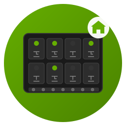

<p align="center">
  
</p>

<h1 align="center">Waveshare Relay Hub for Home Assistant</h1>

<p align="center">
  <a href="https://github.com/shubham030/waveshare_relay/releases"></a>
  <a href="https://github.com/shubham030/waveshare_relay/blob/main/LICENSE"></a>
  <a href="https://github.com/hacs/integration"></a>
</p>

<p align="center">
  <strong>Production-ready Home Assistant integration for <a href="https://www.waveshare.com/">Waveshare</a> Modbus RTU Relay modules via RS485 TO ETH (B) gateway.</strong>
</p>

---

## ✨ Features

| Feature | Description |
|---------|-------------|
| 🔄 **Robust Connection** | Automatic retry logic with exponential backoff |
| ⚡ **Circuit Breaker** | Prevents system overload during failures |
| 📊 **Smart Polling** | Adaptive polling intervals based on network conditions |
| 🔍 **State Verification** | Ensures commands actually succeeded |
| 💾 **State Persistence** | Restores relay states after HA restart |
| 🏠 **Device Registry** | Proper HA device integration |
| ⚙️ **Config Flow** | Easy setup via Home Assistant UI |
| 🔧 **YAML Support** | Advanced configuration via YAML |

## 🛠 Supported Hardware

> All products available at [waveshare.com](https://www.waveshare.com/)

| Component | Model | Product Link |
|-----------|-------|--------------|
| **Gateway** | RS485 TO ETH (B) | [Product Page](https://www.waveshare.com/rs485-to-eth-b.htm) |
| **Gateway** | RS485 TO POE ETH (B) | [Product Page](https://www.waveshare.com/rs485-to-poe-eth-b.htm) |
| **Relay** | Modbus RTU Relay 8CH | [Product Page](https://www.waveshare.com/modbus-rtu-relay-8ch.htm) |
| **Relay** | Modbus RTU Relay 16CH | [Product Page](https://www.waveshare.com/modbus-rtu-relay-16ch.htm) |
| **Relay** | Modbus RTU Relay 32CH | [Product Page](https://www.waveshare.com/modbus-rtu-relay-32ch.htm) |

## 📦 Installation

### Option 1: HACS (Recommended)

1. Open HACS in Home Assistant
2. Click **⋮** → **Custom repositories**
3. Add `https://github.com/shubham030/waveshare_relay` as **Integration**
4. Search for "Waveshare Relay Hub" and install
5. Restart Home Assistant
6. Go to **Settings** → **Devices & Services** → **Add Integration**

### Option 2: Manual Installation

```bash
cd /config/custom_components/
git clone https://github.com/shubham030/waveshare_relay.git
```

Restart Home Assistant.

## ⚙️ Configuration

### Via UI (Recommended)

1. Go to **Settings** → **Devices & Services**
2. Click **Add Integration**
3. Search for "Waveshare Relay Hub"
4. Enter your device details

### Via YAML

```yaml
waveshare_relay:
  - host: 192.168.1.100
    port: 502
    name: "Living Room Relays"
    device_address: 1
    timeout: 5
    num_relays: 32
    restore_state: true
    lights:
      - name: "Ceiling Light"
        address: 1
      - name: "Wall Light"
        address: 2
    switches:
      - name: "Fan"
        address: 3
      - name: "Heater"
        address: 4
```

### Configuration Options

| Option | Required | Default | Description |
|--------|----------|---------|-------------|
| `host` | ✅ | - | IP address of RS485 gateway |
| `port` | ❌ | 502 | TCP port |
| `name` | ✅ | - | Friendly name for this hub |
| `device_address` | ❌ | 1 | Modbus device address (1-255) |
| `timeout` | ❌ | 5 | Connection timeout (seconds) |
| `num_relays` | ❌ | 32 | Number of relays (8/16/32) |
| `restore_state` | ❌ | true | Restore states on restart |
| `poll_interval` | ❌ | 30 | Polling interval (seconds) |

## 🔍 Troubleshooting

### Enable Debug Logging

```yaml
logger:
  default: info
  logs:
    custom_components.waveshare_relay: debug
```

### Common Issues

| Issue | Solution |
|-------|----------|
| Connection timeout | Check device IP and network connectivity |
| Invalid response | Verify device address and Modbus settings |
| State not updating | Check relay configuration and addresses |
| Entities missing | Ensure `address` values are within `num_relays` |

## 🧪 Development

```bash
# Create virtual environment
python3.11 -m venv test_env
source test_env/bin/activate
pip install -r requirements-test.txt

# Run tests
pytest tests/ -v
```

**Test Coverage: 97%**

## 📚 Documentation

- [Configuration Guide](docs/configuration.md)
- [Troubleshooting Guide](docs/troubleshooting.md)
- [HACS Setup](docs/hacs-setup.md)
- [Waveshare Wiki](https://www.waveshare.com/wiki/Modbus_RTU_Relay)

## 🤝 Contributing

1. Fork the repository
2. Create a feature branch
3. Make your changes with tests
4. Submit a pull request

## 📄 License

MIT License - see [LICENSE](LICENSE) for details.

## 🔗 Links

- [GitHub Repository](https://github.com/shubham030/waveshare_relay)
- [Issue Tracker](https://github.com/shubham030/waveshare_relay/issues)
- [Waveshare Official Site](https://www.waveshare.com/)
- [Waveshare Wiki](https://www.waveshare.com/wiki/Main_Page)
- [Home Assistant Community](https://community.home-assistant.io/)
